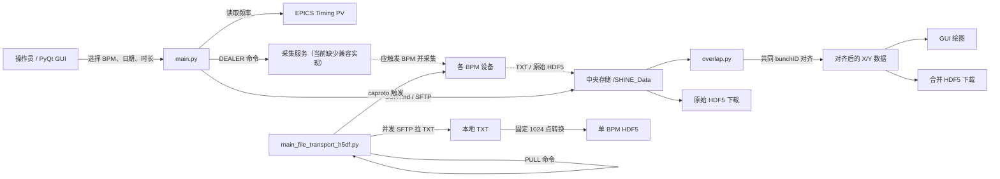

> 历史资料：保留当时记录；当前阶段状态和入口请看[当前状态](../../CURRENT_STATUS.md)。本文件于 2026-10-07 整理迁入此目录。

# 波形存储系统：项目功能与文件说明

> 整理说明：本文记录的是 2026-07-24 目录重排之前的原始项目结构。当前文件位置和首次 Git 基线请以仓库根目录 `README.md` 为准；问题跟踪请参阅 `docs/问题清单与改进路线.md`。

> 分析日期：2026-07-24  
> 分析方式：静态阅读项目根目录及 `StreamDataPro.zip` 内全部文件；对 21 个 Python 文件做了语法解析；比较了主要版本差异和重复文件。  
> 注意：没有连接现场 EPICS、ZMQ、SSH 或 Kafka 服务，也没有在目标 Linux 环境运行 GUI。因此本文确认的是代码结构和静态行为，不代表现场链路已经运行验证。

## 1. 项目结论

这个目录并不是一份已经整理好的单体项目，而是两条主线和一批历史试验文件的集合：

1. `StreamDataPro.zip` 是面向操作员的 PyQt5 GUI 项目，主要负责：
   - 选择 BPM 设备和采集时长；
   - 从 EPICS 读取机器频率；
   - 通过 ZMQ 向采集端发送命令；
   - 通过 SSH 检索中央存储中的原始 HDF5 文件；
   - 按共同 `bunchID` 对齐多个 BPM 的 X/Y 数据；
   - 绘图、下载原始数据或导出对齐后的 HDF5。
2. 根目录的 `main_file_transport_h5df.py` 是无界面的采集/搬运原型，主要负责：
   - 监听 ZMQ 开始命令；
   - 通过 EPICS 批量触发 BPM；
   - 并发 SSH/SFTP 连接多个设备；
   - 下载 TXT 波形；
   - 把 TXT 转成固定结构的 HDF5。

两条主线目前没有真正闭合：

- GUI 使用 ZMQ `DEALER`，发送 `频率,时长,[BPM列表]`，并等待服务端回复；
- 根目录采集脚本使用 ZMQ `PULL`，只接受可直接转成整数的频率，不会回复；
- ZIP 内的 `zmq_server_rout.py` 虽然使用 `ROUTER`，但只接收一次消息，没有回复和采集逻辑，并且导入了不存在的模块。

因此，当前目录更像“GUI、采集端原型、数据处理代码和历史实验的备份包”，还不是可以从源码直接部署的一套完整系统。

## 2. 建议认定的当前主线

| 层次 | 建议主文件 | 说明 |
|---|---|---|
| GUI 入口 | `StreamDataPro/main.py` | 功能最完整，包含采集、锁、检索、对齐、绘图和下载 |
| GUI 布局 | `StreamDataPro/mainWindow.ui` | Qt Designer 源文件 |
| 生成界面代码 | `StreamDataPro/mainWindow.py` | `main.py` 实际导入的界面类 |
| 数据处理 | `StreamDataPro/overlap.py` | SSH 查找/读取 HDF5、bunchID 对齐、绘图和导出 |
| 通用配置读取 | `StreamDataPro/utils.py` | 读取 PV/IP 配置，另含早期 HDF5 和触发试验代码 |
| GUI ZMQ 客户端 | `StreamDataPro/zmq_client_dealer.py` | `main.py` 实际调用的命令发送模块 |
| BPM 全量顺序 | `StreamDataPro/pv_list_ALL.txt` | 用于把远程 HDF5 按机器设备顺序排列 |
| 采集端原型 | `main_file_transport_h5df.py` | 当前唯一明确执行“触发、拉取 TXT、转 HDF5”的脚本，但接口尚未与 GUI 对齐 |

`main_zyf.py` 不是明显更旧的残缺版：它与 `main.py` 很接近，而且修掉了 `main.py` 中一个会阻断 ZMQ 发送的错误。但它使用另一台服务端地址，并把锁文件放在当前目录。重构前应先由现场人员确认哪台服务端和哪套锁路径才是正式配置。

## 3. 系统功能与数据流



虚线部分代表从项目意图推断出的现场链路；当前仓库没有一份与 GUI 协议兼容、能够完整执行采集并回复结果的服务端实现。

### 3.1 GUI 采集流程

`main.py` 中的主要过程：

1. 启动时加载 Qt 界面，并默认选中 `BPMS_TO_STORE` 中的 12 个 BPM。
2. 用户选择锁定时长和 BPM，点击 `Start Capture`。
3. 程序读取 EPICS PV `AC-LA-INJ1-TIM:WRN1:MCFQ8` 得到机器频率。
4. 把按钮对象名转换为规范设备名。
5. 组装消息：`频率,分钟数,[设备名列表]`。
6. 使用 `zmq_client_dealer.send_start()` 发往固定采集服务器并等待最多 3 秒的回复。
7. 文件锁和 JSON 状态文件用于阻止短时间内重复触发。

### 3.2 数据检索、对齐与导出流程

1. 用户选择日期，GUI 形成 `/SHINE_Data/AC/LA/YYYYMMDD/raw/BIData/`。
2. `remote_search_time_sec()` 通过 SSH `find` 获取当天 HDF5 文件中的可用时刻。
3. 用户选择一个时刻后，`remote_find_h5_files()` 找到该时刻的全部 BPM 文件。
4. `read_h5()` 逐个下载到临时文件，读取：
   - `BunchIDData[0]`
   - `Data[0, :]`：X
   - `Data[1, :]`：Y
5. `get_overlap_indices_matrix()` 计算多个 BPM 的共同 bunchID，并跳过含 0 或会让交集降得过低的 BPM。
6. `dataprocess()` 按共同 bunchID 的索引抽取对应 X/Y。
7. 结果可以：
   - 在 GUI 中按 BPM 画 X/Y 折线；
   - 保存为一个合并 HDF5；
   - 或直接下载原始 HDF5 文件。

### 3.3 无界面采集脚本流程

`main_file_transport_h5df.py` 的循环意图：

1. 从 `duration_list.txt` 读取总采集时长。
2. 在 `5000` 端口等待 ZMQ 消息，消息被解释为频率。
3. 从 `pv_list.txt` 读取采集 PV 和设备地址。
4. 使用 caproto 对所有 PV 执行 `0 → 1 → 等待 5 秒 → 0`。
5. 根据频率额外等待，使不同频率大致积累一批数据。
6. 最多 17 个线程并发登录 BPM 主机，从 `/home/data` 拉取新 TXT。
7. TXT 每行按 `x y bunchID` 解析，X/Y 除以 1000 后转为整数。
8. 每个 TXT 生成一个包含 `BunchIDData` 和 `Data` 的 HDF5。

## 4. 全部文件说明

### 4.1 项目根目录

| 文件 | 类型/定位 | 作用 | 当前判断 |
|---|---|---|---|
| `main_file_transport_h5df.py` | 采集端原型 | ZMQ 等待命令、EPICS 触发、并发 SFTP 拉 TXT、TXT 转 HDF5 | 重要，但缺少所需配置，且协议与 GUI 不兼容 |
| `StreamDataPro.zip` | 源码归档 | 包含 GUI、数据处理、配置、历史版本、测试和样例数据 | 主要项目内容被压在归档中，不利于版本管理和修改 |

### 4.2 ZIP 内：当前 GUI 主线

| 文件 | 作用 | 依赖/被谁使用 | 备注 |
|---|---|---|---|
| `main.py` | 当前功能最完整的 PyQt5 GUI 入口 | 导入 `mainWindow.py`、`overlap.py`、`zmq_client_dealer.py` | 包含锁管理、设备选择、采集命令、SSH 检索、绘图和下载 |
| `mainWindow.ui` | Qt Designer 界面源文件 | 应由 `pyuic5` 生成 Python UI | 包含 BPM 按钮、时长、日期、时刻、绘图和下载控件 |
| `mainWindow.py` | 由 Qt UI 生成的界面类 `Ui_StreamData` | 被 `main.py`、`main_zyf.py` 等导入 | 不应手工维护；文件头记录的 UI 文件名与现存文件名不一致 |
| `overlap.py` | 远程 HDF5 检索和 bunchID 对齐核心 | 被 `main.py` 使用 | 同时承担 SSH、SFTP、数据算法、绘图和写文件，职责过重 |
| `utils.py` | PV/IP 配置读取和早期工具函数 | `main.py` 只导入但当前主要流程几乎未使用 | `startBPMs()` 缺少 `Context`、`Batch` 导入，直接调用会报错 |
| `zmq_client_dealer.py` | ZMQ `DEALER` 客户端 | 被 `main.py` 使用 | 以本机 IP 作为 identity，发送命令后等待回复；另有等待消息函数 |
| `pv_list_ALL.txt` | 47 个 BPM 的 PV、IP、端口清单 | `main.py` 用它生成标准设备排序 | 内容是“每行 JSON + 行尾逗号”，不是标准整体 JSON |
| `SWITCH_PV_IP.txt` | 12 个默认采集 BPM 的 PV/IP 清单 | `utils.py`、早期 ZMQ 服务端使用 | 与 `main.py` 内嵌的默认设备集合大体对应 |
| `BPMS_TO_STORE.txt` | 默认 BPM 分组草稿 | 当前主线没有读取 | 内容不是合法 JSON，且 `INJ1` 第一项缺少左引号；实际配置被重复写在 Python 常量中 |
| `main.spec` | PyInstaller 打包配置 | 入口为 `main.py` | `datas=[]`，没有把配置/UI 文件加入包；打包后相对路径读取可能失败 |
| `aa.txt` | Linux x86-64 Conda 显式环境导出 | 环境重建参考 | 主要列出 Python、PyQt、NumPy 等，未完整覆盖代码所需的 Paramiko、h5py、pandas、matplotlib、pyzmq、caproto 等 |

### 4.3 ZIP 内：主线变体和备份

| 文件 | 作用 | 与主线的关系 |
|---|---|---|
| `main_zyf.py` | GUI 入口变体 | 与 `main.py` 仅少量差异：改用 `overlap_zyf.py`、本地锁文件、另一 ZMQ 服务地址，并且没有 `time.strptime()` 阻断错误 |
| `overlap_zyf.py` | 对齐处理变体 | SHA-256 与 `overlap.py` 完全一致，是纯重复文件 |
| `main_bak251105.py` | 2025-11-05 左右的 GUI 备份 | 有锁、采集、检索和下载，但没有后加的 bunchID 确认/绘图功能 |
| `mainWindowzyf.py` | 较旧的小尺寸生成式 UI | 与 `mainWindow_bak251105.py` 只差一个控件对象名；不匹配当前完整 GUI |
| `mainWindow_bak251105.py` | 较旧生成式 UI 备份 | 基本对应早期界面布局 |
| `mainWindow_bak251105.ui` | 较旧 Qt Designer UI 源文件 | 缺少当前界面中的新绘图/选择控件，窗口尺寸也更小 |
| `main1.py` | 更早的 GUI 原型 | 使用简单 ZMQ `PUSH`，依赖不存在的 `h5_data_process.py`，下载合并功能未完成 |
| `SWITCH_PV_IP_1.txt` | 16 个 BPM 的配置变体 | 比 `SWITCH_PV_IP.txt` 多 4 台设备，包含一个不同端口；没有明确代码引用 |

### 4.4 ZIP 内：ZMQ 和采集通信试验

| 文件 | 作用 | 当前问题 |
|---|---|---|
| `zmq_client.py` | 最早的 ZMQ `PUSH` 客户端 | 文件被导入时会立即向本机发送 `"100"`，存在意外副作用 |
| `zmq_server.py` | ZMQ `PULL` 接收试验，附带 EPICS 触发函数 | 启动后只接收一条消息就退出；收到消息后没有调用 `startBPMs()` |
| `zmq_server_rout.py` | ZMQ `ROUTER` 接收试验 | 只收一次、不回复、不启动采集；导入名 `zmq_client_delear` 拼错且模块不存在 |
| `main_file_transport_h5df.py`（根目录） | 更接近真实采集端的实现 | 仍使用 `PULL`，只接受整数频率，无法解析当前 GUI 的复合消息 |

### 4.5 ZIP 内：文件锁和状态试验

| 文件 | 作用 | 当前判断 |
|---|---|---|
| `fcntl_test.py` | PyQt 按钮锁定/倒计时/恢复状态的独立演示 | 是后来合入 `main.py` 的 `LockManager` 原型 |
| `deepseek_python_20251015_f3652f.py` | 更复杂的共享存储互斥管理原型 | 结合 `flock`、状态 JSON、PID/主机名、信号和超时清理；没有接入主线 |
| `button_lock.lock` | 空的运行时锁文件 | 不应作为源码长期保存 |
| `lock1.txt` | 空的锁试验文件 | 不应作为源码长期保存 |
| `lock_status.json` | 主锁状态快照 | 保存了历史“锁定中”状态；运行时状态不应放入发布包 |
| `status1.json` | 旧锁试验状态快照 | 包含历史 PID 和状态，不属于源码 |
| `json_test.py` | 检查 Linux 状态文件权限并读取 JSON 的试验 | 路径硬编码，仅用于诊断 |

### 4.6 ZIP 内：HDF5 样例和测试

| 文件 | 作用 | 静态识别结果 |
|---|---|---|
| `20251005_234917_BPMdata.h5` | 多 BPM 对齐后导出的样例 | 包含 `BunchIDData`、`Data`、`Device` 和各 BPM X/Y 属性；可识别到 12 个设备名 |
| `test.h5` | 单 BPM HDF5 写读试验样例 | 包含 `BunchIDData`、`Data`、`Device=bpm_name`、`Data_0=bpm_x`、`Data_1=bpm_y` |
| `test` | 无扩展名的 HDF5 样例 | 文件头确认是 HDF5，至少包含 `BunchIDData` 和 `Data` |
| `test.py` | PV 名规范化和按全量清单排序的试验 | 逻辑后来用于远程文件排序 |

### 4.7 ZIP 内：与波形存储主线关系较弱的报警/Kafka 文件

| 文件 | 作用 | 当前判断 |
|---|---|---|
| `main_pyepics.py` | Kafka + EPICS 的报警监视 GUI | 属于另一个 Alarm/MPS 项目；依赖缺失的 `blinkingLabel.py`、`mainWindow1.py` 和多项 `utils` 函数 |
| `test1,py.py` | 报警 GUI 的导入和环境试验 | 文件名异常；同样依赖缺失模块，且没有形成完整入口功能 |
| `test1-1(1).py` | Kafka `Accelerator` topic 的 MAJOR 报警消费试验 | 导入即开始无限消费；与波形存储主流程无直接关系 |

## 5. 已发现的关键问题

### P0：会阻断核心流程

1. **GUI 正式文件的采集发送被一行代码阻断。**  
   `main.py` 在调用 ZMQ 前执行无参数 `time.strptime()`，该调用会抛出异常，随后被裸 `except` 吞掉，所以采集命令不会发出。`main_zyf.py` 没有这一行。

2. **GUI 与采集脚本协议不兼容。**  
   GUI 是 `DEALER` + 复合字符串 + 等待回复；采集脚本是 `PULL` + `int(message)` + 无回复。即便网络和地址正确，两者也不能直接通信。

3. **根目录采集脚本缺少必需文件。**  
   它读取 `pv_list.txt` 和 `duration_list.txt`，但项目中没有这两个文件；现有配置叫 `pv_list_ALL.txt`、`SWITCH_PV_IP.txt`，字段用途也不完全相同。

4. **当前 GUI 的互斥锁被重复获取。**  
   `startButton_click()` 的条件里调用一次 `acquire_lock()`，进入分支后又调用一次。第二次会覆盖 `self.fd`，可能泄漏第一个文件句柄，并使锁行为难以预测。

5. **服务端实现缺失。**  
   ZIP 中的 `ROUTER` 试验没有回复，也没有采集逻辑；`PULL` 试验同样没有把收到的消息接到 `startBPMs()`。真正在线使用的服务端可能在本项目之外。

### P1：安全性、数据正确性和稳定性风险

1. **SSH 用户名/密码直接写在多个源码文件中。**  
   应立即从源码移出，改用权限受控配置、环境变量、系统密钥环或 SSH key，并轮换已经写入归档的凭据。

2. **SSH 主机密钥无条件接受。**  
   多处使用 `AutoAddPolicy()`，存在连接到伪造主机的风险。

3. **大量裸 `except` 只打印模糊信息。**  
   网络失败、格式错误、权限问题和程序错误会被混成 “something wrong”，现场难以排障。

4. **GUI 线程中执行 SSH、SFTP、HDF5 处理和 `sleep()`。**  
   数据量大或网络慢时界面会卡死，应移动到 `QThread`/线程池，并用信号更新进度。

5. **对齐算法对空数据和异常设备不健壮。**
   - 没有有效文件时，`sets_list[0]`、`indices_matrix[0]` 会越界；
   - 第一个 BPM 含 0 时，基准集合与原索引可能错位；
   - 设备名不在 `pv_list_ALL.txt` 中时，排序的 `.index()` 会抛错；
   - 空 bunchID 列表传给显示/绘图函数会再次越界。

6. **合并 HDF5 的设备元数据可能与数据行错位。**  
   `create_hdf5()` 已经算出剔除异常 BPM 后的 `devicename_new`，但实际写入属性时仍使用原始 `devicename`。如果有 BPM 被跳过，属性数量/顺序可能与 `Data` 行不一致。

7. **采集脚本选择远程目录第一项，不保证是目标文件。**  
   `sftp.listdir()[0]` 没有排序、过滤或按修改时间选择；目录为空也会直接异常。

8. **采集时长判断使用 `YYYYMMDDHHMMSS` 整数相减。**  
   这种计算跨分钟、小时或日期会错误，应使用 Unix 时间戳或 `datetime` 差值。

9. **TXT 转 HDF5 固定创建 1024 点，但不校验有效行数。**  
   少于或多于 1024 行、坏行或列数异常都可能造成写入失败或数据不完整。

10. **采集端使用固定 root/root SSH 登录。**  
    除了明文凭据风险，还违反最小权限原则。

### P2：结构和可维护性问题

1. 正式代码压在 ZIP 内，无法正常使用 Git 追踪逐文件变化。
2. 正式、备份、个人变体、试验和运行时状态都在同一目录。
3. `overlap.py` 同时负责远程命令、文件传输、HDF5、算法和绘图。
4. 配置存在三份以上：Python 常量、`BPMS_TO_STORE.txt`、`SWITCH_PV_IP*.txt`、`pv_list_ALL.txt`。
5. 路径、IP、端口、用户名、采样等待时间和 HDF5 结构均硬编码。
6. `overlap.py` 和 `overlap_zyf.py` 完全重复；多套 `mainWindow*.py/.ui` 关系不清。
7. 多个文件含重复/未使用导入、拼写错误和中英文临时打印。
8. 没有 README、依赖清单、配置示例、日志规范、单元测试或部署说明。
9. `main.spec` 没有声明运行时数据文件，当前相对路径设计不适合 `onefile`。
10. `fcntl` 仅适用于 Unix/Linux，说明主线不能直接在当前 Windows 开发机运行。

## 6. 建议的整理后目录

```text
waveform-storage/
├─ README.md
├─ pyproject.toml
├─ config/
│  ├─ devices.example.yaml
│  └─ app.example.yaml
├─ src/waveform_storage/
│  ├─ gui/
│  │  ├─ app.py
│  │  ├─ main_window.ui
│  │  └─ workers.py
│  ├─ acquisition/
│  │  ├─ server.py
│  │  ├─ epics_trigger.py
│  │  └─ device_fetcher.py
│  ├─ transport/
│  │  ├─ protocol.py
│  │  └─ ssh.py
│  ├─ processing/
│  │  ├─ alignment.py
│  │  └─ hdf5_io.py
│  ├─ config.py
│  └─ logging_config.py
├─ tests/
│  ├─ test_protocol.py
│  ├─ test_alignment.py
│  ├─ test_hdf5_io.py
│  └─ fixtures/
├─ samples/
└─ archive/
   └─ legacy/
```

## 7. 推荐改进顺序

### 第一阶段：先让链路可定义、可测试

1. 解压 ZIP，把源码纳入 Git；保留原 ZIP 作为只读历史快照。
2. 由现场确认唯一正式入口、采集服务器地址、锁目录和数据目录。
3. 定义一个明确的 ZMQ 协议，例如 JSON：

   ```json
   {
     "version": 1,
     "command": "start_capture",
     "request_id": "uuid",
     "frequency_hz": 100,
     "duration_seconds": 600,
     "devices": ["AC_LA_INJ1_BI_SBPM08"]
   }
   ```

4. 服务端必须返回结构化结果，至少包含 `request_id`、`accepted`、`message` 和错误码。
5. 先写不接现场设备的 fake server，验证 GUI → ZMQ → 回复的完整路径。

### 第二阶段：修复阻断错误和安全问题

1. 删除 `time.strptime()` 错误和重复 `acquire_lock()`。
2. 移除源码中的密码并轮换旧凭据。
3. 配置 SSH host key 校验。
4. 合并设备配置为一个合法 YAML/JSON 文件，并做 schema 校验。
5. 把所有硬编码路径、地址、端口和等待参数移入配置。

### 第三阶段：拆分业务层并补测试

1. 从 `overlap.py` 拆出 SSH、HDF5、对齐算法和绘图。
2. 给 bunchID 对齐写边界测试：
   - 空输入；
   - 单设备；
   - 含 0；
   - 无交集；
   - 部分交集；
   - 重复 bunchID；
   - 设备顺序未知；
   - BPM 被跳过后的元数据一致性。
3. 给 TXT → HDF5 增加行数、类型、范围和文件名校验。
4. 网络和数据处理移出 GUI 主线程。
5. 使用 `logging` 记录 request ID、设备、阶段、耗时和完整异常堆栈。

### 第四阶段：清理和发布

1. 把历史文件移到 `archive/legacy`，运行时 `.lock/.json` 加入忽略规则。
2. 删除完全重复的 `overlap_zyf.py`。
3. 报警/Kafka 文件移回对应项目或单独归档。
4. 生成准确的依赖文件和 Linux 部署说明。
5. 修正 PyInstaller 配置，显式包含配置/UI，或彻底采用包内资源读取。

## 8. 改进前需要现场确认的事项

下面几项无法仅靠当前文件可靠判断：

1. `main.py` 和 `main_zyf.py` 哪个服务地址是正式地址？
2. 实际线上是否另有一份未放入项目的 ZMQ 采集服务？
3. GUI 的“时长”是分钟还是秒？当前 GUI 按分钟锁定，但采集端读取的是秒。
4. BPM 主机上的 `/home/data` 是否始终只有一个目标 TXT？文件命名和完成写入标志是什么？
5. 原始 HDF5 是否保证每台设备都是 1024 点、唯一 bunchID、相同 dtype？
6. “交集低于第一个有效 BPM 的 50% 就跳过设备”是否是确认过的物理/业务规则？
7. 对齐后 HDF5 的正式 schema、单位、缩放比例和设备顺序是什么？
8. 锁的目标是“所有操作员全局十分钟只能触发一次”，还是“同一客户端防重复点击”？

这些答案应先写成接口与数据规范，再开始大规模重构，否则很容易把历史偶然行为固化成新设计。
