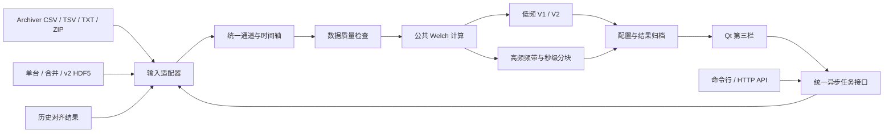

# 统一频谱分析设计

本设计对应 2026 年 10 月 7 日的下一阶段目标：接入 Archiver 导出和波形存储导出，在软件侧栏增加“频谱分析”。

## 数据与任务结构

输入来源与分析模板分开。Archiver 可使用高频模板，HDF5 可使用低频模板。实际采样率、连续时长和目标频带决定可分析性。

## 模块边界

| 模块 | 职责 |
| --- | --- |
| `analysis/models.py` | 通道、配置、请求与结果契约 |
| `analysis/loaders.py` | 两种输入适配器、HDF5 元数据和缺失掩码 |
| `analysis/numerics.py` | 统一 Welch 数值计算 |
| `analysis/pv_engine/` | 从原项目迁入的低频 V1/V2 计算与分类 |
| `analysis/engine.py` | 质量检查、模板选择、高频频带及独立分块 |
| `analysis/service.py` | 异步任务、进度、取消、可复现结果和下载 |
| `analysis/status.py` | 兼容机器分类到五种用户显示状态的统一映射 |
| `analysis/http_api.py` | 统一任务 HTTP 接口，限制输入根目录 |
| `gui/spectrum_panel.py` | 本地选择文件、参数、结果表、频谱图和结果保存 |

GUI 使用同一服务的本地调用，无需额外启动 HTTP 服务。HTTP 服务和命令行用于独立运行与后续集成。采集服务协议不承担本地频谱计算。

## 时间轴与质量规则

- Archiver 使用每点真实时间戳，保留时区解释与原始来源。
- HDF5 使用文件记录的采样率，或用户明确提供的采样率。bunchID 数值不能直接推断为 Hz。
- HDF5 保留相对时间；采集轮次开始时间只记为来源信息。
- 保留 bunchID 间隔和 v2 有效掩码，短缺口可按参数插值，长缺口输出明确无效原因。
- X/Y 真零默认保留。“双零无效”只有显式选择时应用，并记录在配置中。
- 检查有效点、常值、时长、Nyquist、目标频带、采样抖动和分块数量。
- 每个通道读取或分析失败单独输出原因，并标记为“无法分析”；不能映射为“无显著谱峰”。

## 分析模板

| 模板 | 初始参数 | 解释范围 |
| --- | --- | --- |
| 低频 V1/V2 | 目标 0.152 Hz；Welch 300 秒；独立块 300 秒 | 沿用原算法口径，记录版本与门槛 |
| 高频频带 | 搜索 40 Hz～50 Hz；Welch 5 秒；独立块 5 秒 | 本次记录内的频谱和重复性，门槛为探索性参数 |

高频分块必须在整体谱峰附近重复命中，避免不同块在宽频带内命中不同噪声谱峰。500 Hz 和 1,000 Hz 使用相同秒级参数，样本数随采样率变化。窗口短于记录时显示实际频率分辨率。

频谱候选表示统计筛选结果。相位、相干性和物理原因判定不由当前候选标签推导，后续可在统一时序层扩展。

## 任务与结果

任务状态为 `accepted`、`running`、`succeeded`、`failed` 和 `cancelled`。一个服务实例限制并发任务，取消在通道边界检查。界面轮询状态，计算和文件读取在后台线程执行。

每次运行保存配置、来源 hash、时间轴依据、数据质量表、逐通道汇总、分块表、频谱数组、JSON 结果、Markdown 报告与 ZIP 下载包。GUI 绘图在主线程执行。

## 界面状态与绘图

普通参数区只显示分析模板和本次采样率。零值策略及技术参数位于默认折叠的“高级分析参数”区域。展开和收起不会修改参数值；切换模板仍应用对应模板的默认值。

结果表保留 5 列，使用 `setColumnHidden` 默认隐藏“命中块”。高级区域内的“显示命中块列”是独立显示偏好，不进入 `AnalysisConfig` 或模板默认值，不触发分析提交。结果刷新保留该偏好，结果包保存全部分块数据。

频谱图默认使用“原始”模式，即 PSD 原始数值和线性 Y 轴。“原始”不表示原始时间域波形；“Log”使用同一份 PSD 数据和对数 Y 轴。切换模式只重绘当前通道，保存图片时保留当前模式。Log 绘制会屏蔽非正值，不会用 epsilon 替换线性模式的 PSD 数据。

用户显示状态由 `analysis/status.py` 集中映射：谱峰显著性与重复性均通过时为“谱峰明显”；整体谱峰条件通过但重复性不足时为“谱峰较明显”；只有部分支持证据时为“观测项”；数据正常但证据不足时为“无显著谱峰”；数据质量或数值失败时为“无法分析”。这些状态表示统计筛选，不是自动物理故障判定。

机器字段 `classification` 保留 `stable_candidate`、`observation`、`reject` 和 `invalid` 原值。结果 schema 版本 2 增加 `display_status` 状态码，结果包同时提供旧机器分类和当前显示状态；GUI 与 Markdown 报告由同一状态码生成。`peak_hz`、`peak_to_background_db`、PSD 和频率数组保持原字段与数值。

`display_status` 的状态码为 `clear_peak`、`probable_peak`、`watch`、`no_significant_peak` 和 `unanalysable`。运行清单记录状态 schema 版本及状态码到中文标签的映射。

## 界面接入与验证

侧栏顺序为“采集控制”“历史检索与绘图”“频谱分析”。第三栏支持文件或目录导入、模板选择、采样率、高级分析参数、显示模式和结果保存。历史页面提供“频谱分析”入口，将当前对齐结果交给第三栏。

历史采样率来自当前 `CaptureRunSummary.frequency_hz`，不是 `AlignmentResult` 或 `CaptureSegment` 的字段。operator 检查当前任务与 segment 的 `request_id` 一致，再显式传给 `SpectrumPanel.use_alignment`。现有 generation 检查和历史上下文清理保证对齐结果对应当前真实 `capture_sequence`。合法采样率须为非布尔数值、有限值且大于 0；缺失或无效时保持人工输入。频谱页不新增历史查询，直接 HDF5 和 Archiver 入口沿用原有时基规则。

验证覆盖 500 Hz / 1,000 Hz 的同一已知信号、BOM 与两列数值回退、ZIP、三种 HDF5、缺失和时基错误、低频迁移一致性、异步任务、API 路径限制和 Qt 点击流程。使用现有真实 HDF5 进行一次试运行，并检查第三栏的离屏截图。
