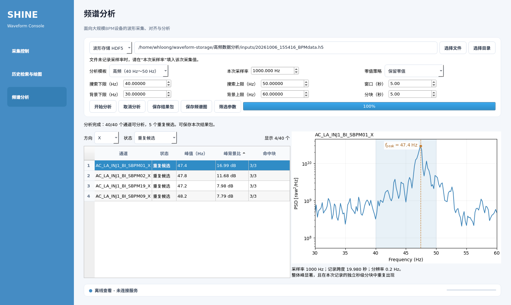

# 频谱分析验证记录

本记录对应 2026 年 10 月 7 日新增的统一频谱分析与 Qt 第三栏。本机源码和独立可执行预览均已验证。

## 2026 年 10 月 9 日 r3 验证

本机 operator `20261009-spectrum-ui-r3` 已构建并激活。用户于同日确认已完成人工桌面验证。Git 保存阶段保持 current 不变，未重新构建或部署，也未修改现场 server。

频谱专项 27 项、历史专项 5 项和完整质量门 216 项均通过。release 的 8,368 项 manifest 校验通过，源码清单包含两个修改后的 GUI 模块。新二进制的 offscreen 页面启动、隐藏列、高级区域选项、历史按钮采样率传递和自适应 PNG 文件名检查通过。首次频谱 HTTP 测试受 sandbox loopback socket 限制，随后在允许 loopback 的环境中重跑通过。

新增覆盖包括命中块显示偏好保持、切换时不提交分析、完整结果包、1000 Hz 与 500 Hz 历史率、缺失及无效率、切段清理、真实 sequence 跳号和旧 schema 结果读取。完整记录见 [r3 交付说明](../交付/20261009-spectrum-ui-r3/README.md)。以下各节保留早期验证时的测试数和部署状态。

## 2026 年 10 月 8 日界面与状态语义修改

本轮源码修改将常用参数收敛为分析模板和本次采样率，其余参数默认折叠在“高级分析参数”中；频谱图新增“原始”（PSD 原始数值、线性 Y 轴）和“Log”（同一 PSD、对数 Y 轴）显示。模式切换只重绘当前通道，保存图片使用当前显示模式。

结果增加五种显示状态：谱峰明显、谱峰较明显、观测项、无显著谱峰和无法分析。原 `classification` 机器值保持不变；结果 schema 版本 2 增加 `display_status`，运行清单包含状态 schema 版本和标签映射。低频 V1/V2 golden 数值保持原值。

频谱 focused tests 使用项目 Python 3.10 环境运行，共 21 项通过，命令如下：

```bash
MPLCONFIGDIR=/tmp/waveform-storage-mpl PYTHONPATH=src QT_QPA_PLATFORM=offscreen \
  /home/whloong/miniconda3/envs/waveform-storage/bin/python \
  -m unittest discover -s tests -p 'test_spectrum_*.py' -v
```

项目常规质量门共 209 项测试通过，并完成编译、设备注册表、源码质量、敏感信息扫描和 diff 检查：

```bash
MPLCONFIGDIR=/tmp/waveform-storage-mpl QT_QPA_PLATFORM=offscreen \
  /home/whloong/miniconda3/envs/waveform-storage/bin/python tools/run_quality.py
```

本轮未构建预览包或安装包，未切换正式 `current`，未部署，未修改 server 或 systemd，也未 push、创建 tag 或 commit。

## 自动验证

质量检查通过 185 项测试，覆盖原采集、历史与日志功能，以及新增数值计算、输入读取、异步任务、HTTP 接口和 Qt 操作。

| 验证内容 | 结果 |
| --- | --- |
| 500 Hz、1,000 Hz 下的已知 47.6 Hz 信号 | 谱峰频率一致，分块样本数随采样率变化 |
| 低频 V1/V2 迁移 | 与原程序生成的固定信号基准数值一致 |
| Archiver 输入 | BOM、时间戳、数值列回退、TXT 名称和 ZIP 读取通过 |
| HDF5 输入 | 单台、交错合并、v2 掩码读取通过；缺失或冲突采样率明确处理 |
| 时基与质量 | 保留 ID 缺口；长缺口、常值、行标签错误和频带覆盖不足明确无效 |
| 高频重复性 | 不同分块的漂移谱峰不会误记为同一个重复谱峰 |
| 任务与结果 | 取消不留下半成品；重启保留结果；同一目录的服务实例互斥 |
| HTTP 接口 | 提交、状态、结果下载和允许目录限制通过 |
| Qt 界面 | 第三栏分析、历史对齐结果转入和结果导出通过 |

低频计算保留原算法与配置来源。新增质量检查会拒绝长缺口或背景频带覆盖不足的数据，因此旧任务的分类总数可能变化。迁移来源与文件摘要见 `src/waveform_storage/analysis/pv_engine/provenance.json`，数值基准见 `tests/fixtures/spectrum-low-frequency-golden.json`。

## 真实文件试运行

输入为 `analysis/high_frequency/inputs/20261006_155512_BPMdata.h5`。文件包含 20 台设备的 X/Y，共 40 个通道，每通道 19,922 个点。

文件没有采样率字段。本次填写 1,000 Hz，保留零值，采用 40 Hz～50 Hz 高频模板、5 秒 Welch 窗口和 5 秒独立分块。这是填写值下的试运行，不是文件采样率的独立测量。

| 项目 | 结果 |
| --- | --- |
| 可分析通道 | 40 |
| 旧版 `stable_candidate` 分类 | 4 |
| 旧版 `observation` 分类 | 32 |
| 旧版 `reject` 分类 | 4 |
| 旧版 `invalid` 分类 | 0 |
| 首通道 `AC_LA_INJ1_BI_SBPM01_X` 谱峰频率 | 47.6 Hz |
| 首通道分辨率 | 0.2 Hz |
| 首末样本时间差 | 19.921 秒 |
| 首通道完整分块命中 | 3/3 |

源码与当时的可执行预览结果一致。以上数字使用旧版机器分类，不能直接作为当前五种显示状态的计数。统计重复性不等同于物理原因或束流状态确认。

## 界面和交付

界面在 1,120 × 720 与 1,440 × 900 的尺寸下检查过。功率谱密度单位使用 Matplotlib 的 LaTeX 兼容数学渲染，保留源码，公式与坐标轴完整可见。


预览启动入口为 `tools/run_spectrum_preview.sh`。本机当前版本由 `outputs/operator-local/current/` 指向；当前源码包为 `outputs/spectrum-preview/waveform-operator-formal-1b3095d8053a.tar.gz`，配套 SHA-256 文件记录完整性。未采用的中间包集中保留在 `archive/build-artifacts/spectrum-preview/20261007/`。

本机可执行预览包含 pandas、SciPy 与原低频参数资源，已验证实际 HDF5 分析和 Archiver 固定信号的低频 V2 分析。后者谱峰频率为 0.1533333333 Hz，6/6 个完整分块命中，与源码基准一致。打包规则显式选用当前 Python 环境的 libexpat，避免本机系统库与 pyexpat 的 ABI 冲突。

桌面机仍使用原可执行版本。本阶段未更新桌面机，也未在桌面系统上验证新依赖；后续更新须使用对应平台的构建流程。已有采集与历史服务的连接配置由 `--connected` 启动入口复用，本次验证使用本地离线分析。

## 本机入口与排版修复

用户通过本机桌面图标运行时，旧可执行文件把工作目录的 `src/` 加入模块搜索路径，加载了新分析代码。旧包未包含 SciPy，导致 `ModuleNotFoundError`。运行进程路径和任务 traceback 均已核对。

修复后，本机桌面和连接入口优先选择 `outputs/operator-local/waveform-operator/`。源码运行继续读取工作目录，打包运行使用包内代码，使代码与依赖对应。启动脚本也接受第三栏和文件导入参数；4 项启动脚本回归测试与原检查合计 189 项通过。

最终包已通过桌面图标所用脚本的实际启动与分析，记录 SciPy 版本为 1.15.3。另用含报错代码的外部 `src/` 核验打包隔离，包内分析仍成功完成。两次验证均得到 40 个可分析通道和相同分类计数。

参数标签和控件现在组成紧邻的一组。普通输入框宽 145 像素，下拉框宽 180 像素，不随大窗口拉长。一排的三组参数均匀分布，组间距随窗口扩展。“本次采样率”与文件缺失字段的提示保持对应。常规和展开参数均已检查，并在 1,120 × 720 和 1,549 × 926 下核对显示。

用户截图中的文件为 `20261006_155416_BPMdata.h5`，与最初试运行文件不同。该文件也没有采样率字段，按填写的 1,000 Hz 试跑，40 个通道均可分析，旧版 `stable_candidate`、`observation` 和 `reject` 分类计数分别为 5、27 和 8。这个结果仍以填写的采样率为条件。


## 谱峰标注、筛选与排序

频谱图显示谱峰点和谱峰频率，使用 LaTeX 兼容数学渲染。结果表支持 X/Y 与五种状态筛选，以及谱峰频率、谱峰背景比、命中块的数值升降序排序。行数据保存原通道索引，筛选和排序后仍能正确选图。空筛选会清空图表，禁止保存旧图。下方历史截图保留 2026 年 10 月 7 日旧版界面，仅用于记录当时的验证，不代表当前状态文案。

当时新增的 Qt 测试覆盖组合筛选、空结果、缺失谱峰频率、9.2 与 10 的数值排序、2 与 10 的命中块排序、通道对应关系、谱峰频率标签和图片导出。版本启动测试还检查当前版本路径被解析为实际目录，已运行版本保留原目录。

当时的质量检查共 192 项测试通过。最终可执行文件与桌面入口均已使用真实 HDF5 完成 40 个通道分析，谱峰频率标签已检查。当前本机版本位于 `outputs/operator-local/releases/20261007-spectrum-results/waveform-operator/`，此前使用的目录原地保留。


