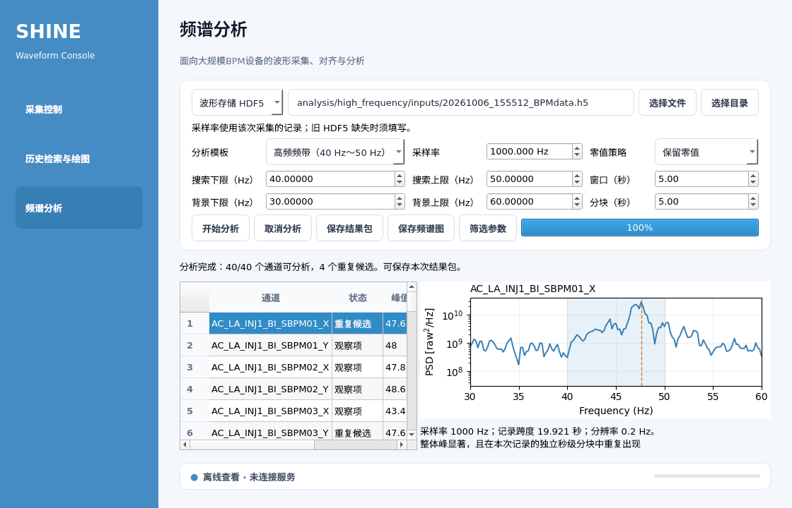

# 频谱分析验证记录

本记录对应 2026 年 10 月 7 日新增的统一频谱分析与 Qt 第三栏。本机源码和独立可执行预览均已验证。

## 自动验证

质量检查通过 185 项测试，覆盖原采集、历史与日志功能，以及新增数值计算、输入读取、异步任务、HTTP 接口和 Qt 操作。

| 验证内容 | 结果 |
| --- | --- |
| 500 Hz、1,000 Hz 下的已知 47.6 Hz 信号 | 峰值一致，分块样本数随采样率变化 |
| 低频 V1/V2 迁移 | 与原程序生成的固定信号基准数值一致 |
| Archiver 输入 | BOM、时间戳、数值列回退、TXT 名称和 ZIP 读取通过 |
| HDF5 输入 | 单台、交错合并、v2 掩码读取通过；缺失或冲突采样率明确处理 |
| 时基与质量 | 保留 ID 缺口；长缺口、常值、行标签错误和频带覆盖不足明确无效 |
| 高频重复性 | 不同分块的漂移峰不会误记为同一个重复峰 |
| 任务与结果 | 取消不留下半成品；重启保留结果；同一目录的服务实例互斥 |
| HTTP 接口 | 提交、状态、结果下载和允许目录限制通过 |
| Qt 界面 | 第三栏分析、历史对齐结果转入和结果导出通过 |

低频计算保留原算法与配置来源。新增质量检查会拒绝长缺口或背景频带覆盖不足的数据，因此旧任务的分类总数可能变化。迁移来源与文件摘要见 `src/waveform_storage/analysis/pv_engine/provenance.json`，数值基准见 `tests/fixtures/spectrum-low-frequency-golden.json`。

## 真实文件试运行

输入为 `analysis/high_frequency/inputs/20261006_155512_BPMdata.h5`。文件包含 20 台设备的 X/Y，共 40 个通道，每通道 19,922 个点。

文件没有采样率字段。本次填写 1,000 Hz，保留零值，采用 40 Hz～50 Hz 高频模板、5 秒 Welch 窗口和 5 秒独立分块。这是填写值下的试运行，不是文件采样率的独立测量。

| 项目 | 结果 |
| --- | --- |
| 可分析通道 | 40 |
| 重复候选 | 4 |
| 观察项 | 32 |
| 未通过项 | 4 |
| 无效通道 | 0 |
| 首通道 `AC_LA_INJ1_BI_SBPM01_X` 峰值 | 47.6 Hz |
| 首通道分辨率 | 0.2 Hz |
| 首末样本时间差 | 19.921 秒 |
| 首通道完整分块命中 | 3/3 |

源码与最终可执行预览的结果一致。重复候选仅描述本次记录内的统计重复性，物理原因与束流状态尚未核对。

## 界面和交付

界面在 1,120 × 720 与 1,440 × 900 的尺寸下检查过。功率谱密度单位使用 Matplotlib 的 LaTeX 兼容数学渲染，保留源码，公式与坐标轴完整可见。

预览启动入口为 `tools/run_spectrum_preview.sh`。本机可执行文件位于 `outputs/spectrum-preview/pyinstaller-dist/waveform-operator/`；源码包为 `outputs/spectrum-preview/waveform-operator-formal-cf99935148d0.tar.gz`，配套 SHA-256 文件记录完整性。未采用的中间源码包集中保留在 `archive/build-artifacts/spectrum-preview/20261007/`。

本机可执行预览包含 pandas、SciPy 与原低频参数资源，已验证实际 HDF5 分析和 Archiver 固定信号的低频 V2 分析。后者峰值为 0.1533333333 Hz，6/6 个完整分块命中，与源码基准一致。打包规则显式选用当前 Python 环境的 libexpat，避免本机系统库与 pyexpat 的 ABI 冲突。

桌面机仍使用原可执行版本。本阶段未更新桌面机，也未在桌面系统上验证新依赖；后续更新须使用对应平台的构建流程。已有采集与历史服务的连接配置由 `--connected` 启动入口复用，本次验证使用本地离线分析。
