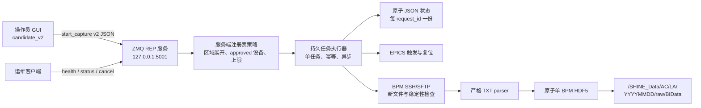

# 新服务端补齐工作交接（2026-07-26）

## 1. 交接摘要

本轮在分支 `codex/communication-v2-experiment`、基线提交
`c2fad0d feat: integrate 383-device registry operator v1` 上补齐了可部署的
candidate v2 采集服务端基线。

当前状态：

- 新服务端源码、真实组件装配、运维客户端、systemd 模板和部署文档已经完成；
- 完整离线质量门禁通过，共 111 项测试；
- 本机独立 localhost 端口的服务启动、health 请求和优雅停止已完成冒烟验证；
- 尚未在 waveform 服务器部署；
- 尚未连接真实 EPICS、BPM SSH 或 `/SHINE_Data` 执行采集；
- 旧 `/home/storage-user/saveApp/saveApp` 和生产端口 5000 未被修改、停止或覆盖；
- 本轮改动已完成代码审查、离线质量门禁，并纳入
  `codex/communication-v2-experiment` 分支的服务端基线提交；接续前仍必须执行实时
  `git status --short` 和 `git log -1 --oneline`，不得只依赖本文判断。

新服务的目标不是直接覆盖旧 `saveApp`，而是先并行部署：

```text
legacy saveApp       0.0.0.0:5000
candidate v2         127.0.0.1:5001
```

初次验证通过 SSH 隧道访问 5001；在确认旧客户端、回滚方式和现场结果之前，不抢占 5000。

## 2. 为什么需要补齐

补齐前仓库已有：

- v2 `CaptureRequest/CaptureResponse`；
- 本地 `FakeZmqServer`；
- `CaptureService`；
- EPICS、设备 SSH、TXT parser 和 HDF5 模块；
- GUI 的显式 `candidate_v2` 模式。

但不能直接部署，主要缺少：

- 常驻生产服务入口；
- 长任务的异步受理；
- 任务持久化、幂等、服务忙和重启恢复；
- health/status/cancel 运维命令；
- 服务端可信注册表展开和灰度白名单；
- 真实 EPICS/SSH/TXT/HDF5 组件装配；
- 远程文件完成判定；
- SSH 主机密钥安全策略；
- systemd、环境模板和现场部署说明。

另外，candidate 客户端默认接收超时约 3 秒，而一次采集可能持续 600 秒。服务端如果同步
等待完整采集再回复，客户端必然超时。因此本轮把服务端设计为“立即受理、后台执行、按
request ID 查询状态”。

## 3. 当前架构



### 3.1 服务协议

支持以下命令：

- `start_capture`：严格 v2 请求；
- `health`：只读健康检查；
- `get_status`：按采集 request ID 查询状态；
- `cancel`：请求在安全边界取消活动任务。

状态模型：

```text
accepted -> running -> succeeded
    |           |
    +---------> failed
    +---------> cancelled

rejected 为终态
```

行为约束：

- 合法 `start_capture` 立即返回 `accepted`；
- 后台线程执行真实采集，ZMQ 服务循环保持可响应；
- 同一时刻只运行一个采集任务；
- 相同 request ID 和相同 payload 返回已保存状态，不重复触发；
- 相同 request ID 配不同 payload 返回 `REQUEST_ID_CONFLICT`；
- 服务忙返回 `SERVICE_BUSY`；
- 服务重启时，原 `accepted/running` 任务标记为
  `INTERRUPTED_BY_RESTART`，不会自动重放；
- 取消在安全边界生效，不强行打断正在执行的 SSH 文件传输。

### 3.2 服务端注册表策略

服务端只从自己的部署注册表展开 `area_ids`，并要求客户端 `devices` 快照完全一致。

只有同时满足以下条件的设备才能采集：

```text
enabled=true
acquisition_enabled=true
存在于部署注册表
```

新增 `select-deployment` 工具用于从正式注册表生成小范围部署子集。它拒绝未知设备、重复设备
和未批准设备，并重新生成连续 order。

服务端还限制：

- 最大采集时长：`WAVEFORM_MAX_CAPTURE_SECONDS`；
- 最大设备数：`WAVEFORM_MAX_CAPTURE_DEVICES`；
- 非 localhost TCP bind 默认拒绝，除非显式设置
  `WAVEFORM_ALLOW_REMOTE_BIND=true`。

### 3.3 任务持久化

默认每个 request ID 保存一份 JSON：

```text
<WAVEFORM_TASK_STATE_DIR>/<request_id>.json
```

记录包含：

- 原始规范化请求；
- 当前响应和状态；
- 带 UTC 时间的状态历史；
- 每设备成功、输出路径和错误；
- 创建和更新时间。

写入采用同目录临时文件、`fsync`、`os.replace` 和目录 `fsync`；状态目录权限收紧为
`0700`，记录文件为 `0600`。

### 3.4 EPICS 行为

当前新实现：

1. 使用注册表中的 `epics_host:epics_port` 生成显式 CA 地址；
2. 设置 `EPICS_CA_AUTO_ADDR_LIST=NO`；
3. 等待每个 PV 连接；
4. 对已连接 PV 批量执行 `0 → 1`；
5. 等待 `WAVEFORM_EPICS_PULSE_SECONDS`，默认 5 秒；
6. 在 `finally` 中批量复位为 0；
7. 单设备连接失败不会阻断后续设备；
8. 如果没有任何设备成功触发，立即以结构化失败结束，不再等待完整采集时长。

注意：这套“单次脉冲后等待完整 duration”的物理语义尚未用真实设备确认。legacy 原型曾在
总时长内按频率重复调用触发流程；不能仅凭旧代码认定新服务的单次触发语义已经正确。单台
现场灰度必须重点确认此项。

### 3.5 SSH 与文件完成判定

新实现不再使用 legacy 的 `listdir()[0]`。

设备下载要求：

- 文件名匹配注册表 `file_pattern`；
- 排除 `.part/.partial/.tmp/.swp`；
- 修改时间不早于任务开始；
- 文件大小大于 0；
- 候选中选择最新文件；
- 等待 settle 时间后，大小和修改时间均保持不变；
- 使用受限线程池并按设备返回结构化结果；
- SFTP 和 SSH 客户端始终关闭。

SSH 安全策略：

- `WAVEFORM_DEVICE_SSH_KNOWN_HOSTS` 必填；
- 预检会解析 known_hosts，并确认每台灰度设备都有主机密钥；
- 未知主机密钥使用 `RejectPolicy` 拒绝；
- 不使用 `AutoAddPolicy`；
- 密码不会进入 settings 表示、公共诊断或结构化日志。

### 3.6 TXT 与 HDF5

TXT parser：

- 每行必须恰好 3 个整数列；
- X/Y 必须在 int64 范围；
- bunchID 必须在 uint64 范围；
- 点数必须与注册表 `expected_points` 一致；
- 不执行未经现场确认的 `/1000` 缩放。

生成单 BPM HDF5：

```text
BunchIDData  uint64 (1,N)
Data         int64  (2,N)
Device       设备 ID
Data_0       bpm_x
Data_1       bpm_y
```

同时保存脱敏采集元数据。HDF5 先写同目录 `.part`，flush 后原子替换正式文件。

输出目录：

```text
/SHINE_Data/AC/LA/YYYYMMDD/raw/BIData/
```

输出文件名：

```text
RAW-HHMMSS-<DEVICE_ID>-S00000.h5
```

## 4. 本轮主要文件

### 新增

| 文件 | 作用 |
|---|---|
| `apps/acquisition_server/main.py` | 服务启动、预检、日志、signal 和组件装配入口 |
| `src/waveform_storage/acquisition/server.py` | ZMQ 服务、注册表策略、持久任务和异步执行 |
| `src/waveform_storage/acquisition/runtime.py` | 服务 settings、真实 EPICS/SSH/TXT/HDF5 装配 |
| `tools/acquisition_v2_client.py` | health/status/cancel 运维客户端 |
| `tests/test_acquisition_server.py` | 服务、持久化、重启、控制命令和安全配置测试 |
| `deploy/systemd/waveform-acquisition-v2.service` | systemd 模板 |
| `deploy/waveform-acquisition-v2.env.example` | 服务端环境变量模板 |
| `docs/candidate_v2服务部署与灰度验证.md` | 完整部署和单台现场验证步骤 |

### 修改

| 文件 | 主要变化 |
|---|---|
| `acquisition/protocol.py` | 增加 health/status/cancel 严格控制请求 |
| `application/capture_service.py` | 只下载成功触发设备；全触发失败立即结束 |
| `transport/epics_gateway.py` | 批量连接、脉冲等待、finally 复位和 context 关闭 |
| `transport/device_ssh.py` | 新文件、临时后缀、mtime、size 和稳定性检查 |
| `transport/zmq_transport.py` | 增加 health/status/cancel 客户端方法 |
| `io/hdf5_io.py` | 增加原子单设备 HDF5 writer |
| `config/registry.py` | 增加 approved 部署子集生成 |
| `gui/experimental_window.py` | 连接模式只发送所选区域内采集已批准设备 |
| `.env.example` | 增加 candidate 服务和客户端配置项 |
| `README.md`、`docs/采集协议v2候选.md` | 更新服务能力和状态 |

## 5. 配置项

服务端主要变量：

```text
WAVEFORM_SERVER_ENDPOINT
WAVEFORM_ALLOW_REMOTE_BIND
WAVEFORM_SERVER_REGISTRY
WAVEFORM_TASK_STATE_DIR
WAVEFORM_STAGING_ROOT
WAVEFORM_LOCAL_DATA_ROOT
WAVEFORM_MAX_CAPTURE_SECONDS
WAVEFORM_MAX_CAPTURE_DEVICES
WAVEFORM_EPICS_CONNECT_TIMEOUT_SECONDS
WAVEFORM_EPICS_PULSE_SECONDS
WAVEFORM_DEVICE_SSH_USER
WAVEFORM_DEVICE_SSH_PASSWORD
WAVEFORM_DEVICE_SSH_KEY_FILE
WAVEFORM_DEVICE_SSH_KNOWN_HOSTS
WAVEFORM_SSH_CONNECT_TIMEOUT_SECONDS
WAVEFORM_SSH_MAX_WORKERS
WAVEFORM_REMOTE_FILE_SETTLE_SECONDS
```

GUI/运维客户端：

```text
WAVEFORM_CANDIDATE_ZMQ_ENDPOINT
WAVEFORM_ZMQ_RECEIVE_TIMEOUT_MS
```

Python 不自动加载普通 `.env`；systemd 使用 `EnvironmentFile=`，手工启动时需要先显式
`source`。

## 6. 验证证据

2026-07-27 提交前最终执行：

```bash
/home/whloong/miniconda3/bin/python3.13 tools/run_quality.py
```

结果：

- 111 项离线测试全部通过；
- compileall 通过；
- 47 台正式注册表校验通过；
- 12 台 acquisition-enabled；
- legacy 清单与正式注册表精确一致；
- 非 legacy 新模块无裸 `except` 和 `print`；
- tracked-source secret heuristic 通过；
- `git diff --check` 通过；
- editable package import 通过。

说明：仓库现有 `.venv` 缺少 pip 和项目运行依赖，因此本次验证使用已安装
`requirements.txt` 全量依赖的 Miniconda Python 3.13。项目声明的最低版本仍为 Python
3.10；服务器部署仍应按 `environment.yml` 创建独立 Python 3.10 环境并重新执行质量门禁。

新增测试覆盖：

- 异步 accepted 和后台终态；
- 相同 request ID 幂等；
- request ID payload 冲突；
- 服务忙；
- 区域—设备快照不一致；
- 时长和设备数量上限；
- health/status/cancel；
- 安全边界取消；
- 任务 JSON 状态历史和设备结果；
- 服务重启中断恢复；
- ZMQ 真实 inproc 服务循环；
- known_hosts 解析与灰度设备覆盖；
- 非 localhost bind 保护；
- 新远程文件和稳定性选择；
- 原子单 BPM HDF5 round trip。

另使用独立本地 TCP 端口完成：

```text
服务入口启动
→ health 客户端收到 accepted=true/status=succeeded
→ SIGINT
→ 服务记录 stopped 并正常退出
```

该冒烟没有发送 `start_capture`，没有连接 EPICS、SSH 或生产服务。

## 7. 部署前必须做的事情

### 7.1 先生成一台设备的灰度注册表

```bash
python tools/device_registry.py select-deployment \
  --registry config/devices.json \
  --device AC_LA_INJ1_BI_SBPM08 \
  --output deploy/devices.gray.json

python tools/device_registry.py validate \
  --registry deploy/devices.gray.json
```

服务器和 GUI 必须使用同一份 `devices.gray.json`。

### 7.2 准备 verified known_hosts

必须通过设备负责人、既有受信记录或独立可信渠道核对主机密钥。`ssh-keyscan` 只能收集当前
返回值，不能单独证明该值可信。

### 7.3 服务器预检

在 waveform 服务器新目录部署，不能覆盖 `~/saveApp`。建议：

```text
/home/storage-user/waveform-storage-v2/
├── app/
├── config/devices.json
├── service.env
├── known_hosts
├── state/
└── staging/
```

执行：

```bash
set -a
source /home/storage-user/waveform-storage-v2/service.env
set +a

python apps/acquisition_server/main.py --check
```

`--check` 不绑定 ZMQ、不访问 EPICS、不连接设备 SSH，但会检查路径、注册表、approved 设备、
known_hosts、localhost bind 和安全限制。

## 8. 建议的现场顺序

完整命令见 `docs/candidate_v2服务部署与灰度验证.md`。接续时保持以下顺序：

```text
固定并记录 Git commit
→ 生成单台灰度注册表
→ waveform 新目录部署
→ 创建独立 Python 环境
→ 运行完整离线质量门禁
→ --check
→ 前台启动 127.0.0.1:5001
→ health
→ EPICS 单台只读确认
→ BPM SSH 只读确认
→ SSH 隧道连接 GUI
→ 单次单台采集
→ status
→ HDF5 schema 和数据检查
→ 再决定是否注册 systemd
```

首轮建议：

```text
WAVEFORM_MAX_CAPTURE_DEVICES=1
WAVEFORM_SSH_MAX_WORKERS=1
WAVEFORM_ALLOW_REMOTE_BIND=false
```

## 9. 现场停止条件

出现任一情况就停止扩大验证：

- timing PV 或设备 PV 无法读取；
- PV 写 1 后无法确认复位 0；
- 服务端任务状态未知；
- 客户端超时后无法通过 status 确认；
- 设备没有产生任务开始后的新文件；
- 文件持续变化或下载不完整；
- HDF5 shape、dtype、属性或点数不符；
- X/Y 是否需要缩放仍无法确认；
- 输出目录或文件名不符合约定；
- 服务意外重启或旧 `saveApp` 受影响。

不要因为客户端超时而用新 request ID 重发采集。

## 10. 仍未完成和必须现场确认

代码基线已补齐，但以下不能表述为已经完成：

1. waveform 服务器的真实部署；
2. candidate 服务在 Deepin 20.9 的依赖兼容；
3. 真实 EPICS PV 连接、写入、复位和频率语义；
4. “单次触发后等待 duration”是否符合设备实际采集逻辑；
5. 设备远程 TXT 命名、mtime、完成时刻和时钟同步；
6. 设备 SSH key/密码和主机指纹；
7. X/Y 单位及是否需要 `/1000` 缩放；
8. 单台生成 HDF5 的现场 round trip；
9. 3 台、一个区段及更大规模的并发和耗时；
10. 旧 `saveApp` 的启动、停止和回滚命令；
11. Linux 单文件/目录可执行包。

waveform 是 Linux，最终若现场只能安装“可执行程序”，应构建 Linux ELF，而不是 Windows
`.exe`。PyInstaller 产物依赖构建系统的 glibc，优先在 waveform 本机或不新于目标系统的
兼容环境构建。当前仓库尚未增加 candidate 服务专用 PyInstaller spec；现场灰度可先使用
源码、独立 Conda 环境和 systemd。

## 11. 接续工作建议

下一位接手时：

1. 先检查实时 Git 状态和当前分支最新提交；
2. 在部署目标的独立环境中再运行 `python tools/run_quality.py`；
3. 确认 waveform 是否允许安装 Conda/Python 环境；
4. 如果只能部署单一可执行产物，新增 candidate 服务 PyInstaller spec，并在兼容 Linux
   环境构建目录包；
5. 不在本机 Ubuntu 构建后直接假定能在 Deepin 20.9 运行；
6. 先完成 5001 单台灰度，再讨论旧 5000 的切换。

## 12. 2026-08-25 MongoDB 与历史查询补齐

本分支新增了可选 MongoDB 元数据目录，并已接入 candidate v2 服务端和操作 GUI：

- `capture_tasks` 保存采集任务和状态历史；
- `waveform_files` 保存每台设备的 HDF5 精确路径、日期时间、shape/dtype、文件大小等；
- `device_registry_versions` 保存脱敏注册表快照；
- candidate v2 新增 `list_capture_times` 和 `find_waveform_files`；
- candidate v2 GUI 的历史查询改为查询服务端 MongoDB，不再远程扫描目录；
- 取得精确路径后，生产模式仍通过存储 SSH 读取/下载 HDF5；
- MongoDB 默认关闭，legacy 模式不受影响。

新增维护工具：

- `tools/backfill_mongodb.py`：校验并幂等回填一个 `YYYYMMDD` 历史目录；
- `tools/verify_mongodb_history.py`：验证 MongoDB → candidate v2 → HDF5 → 对齐；
- `tools/run_local_history_gui.py`：仅在开发机直接读取本地目录，联调 GUI 查询与绘图。

本机使用 Docker MongoDB 8.0.29，Conda 环境 `waveform-storage` 中安装 PyMongo 4.17.0。
本地数据库连接配置保存在被 Git 忽略的 `.env`，不得提交 URI 中的凭据。

已对 `../20251112` 做真实回填和联调：22 个 HDF5、12 台注册表内设备、两个采集时刻。
`11:00:23` 的 10 台设备严格对齐成功，得到 1023 个公共 bunch ID；`15:41:01` 的 12 个
文件均可单独读取，但不存在覆盖全部设备的公共 bunch ID，因此严格对齐为空。GUI 已验证
日期查询、路径查询、本地 HDF5 读取、单设备波形和 `11:00:23` 多设备绘图。

本次不能表述为已完成真实采集。开发机无法连接定时 PV
`AC-LA-INJ1-TIM:WRN1:MCFQ8`，采集请求在读取频率阶段即超时，尚未验证：

1. GUI → 定时 PV → candidate v2 采集请求；
2. 服务端真实 EPICS 触发和复位；
3. 设备 SSH 下载 TXT、生成 HDF5、自动写 MongoDB；
4. 正式存储服务器 SSH 读取；
5. 硬件采集频率变化后的文件格式与容量。

截至本次整理，完整质量门禁为 132 项测试通过。MongoDB 运行期写失败采用 best effort，
尚无 outbox；除 `20251112` 外的既有历史目录尚未批量回填。
